# One Char to Rule Them All: Systematically Exploring and Exploiting DNS Silent Vulnerabilities in Domain Name Resolution

# 1、前置知识——DNS解析流程

## 1.1、DNS的角色


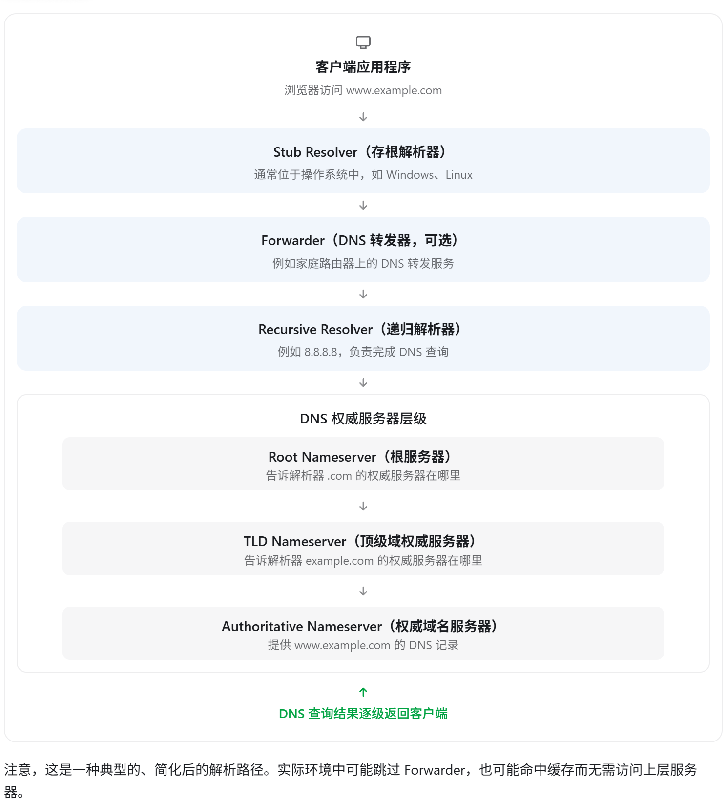

## 1.2、DNS解析流程


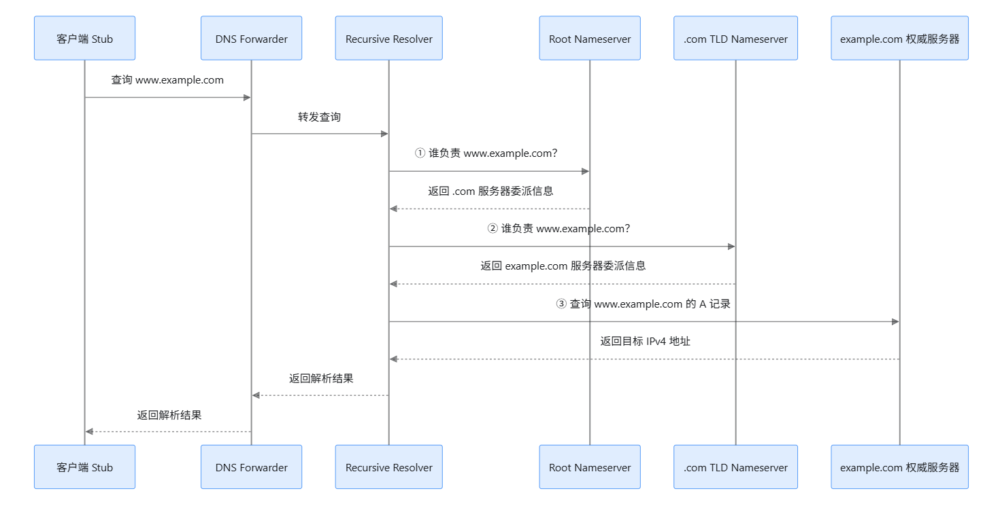


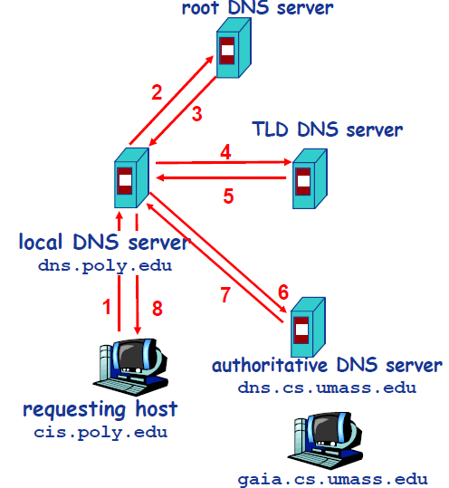

1. 首先，主机 `cis.poly.edu` 向本地 DNS 服务器 `dns.poly.edu` 发送一个 DNS 请求，该查询报文包含被转换的域名 `gaia.cs.umass.edu`。
2. 本地 DNS 服务器 `dns.poly.edu` 检查本机缓存，发现并无记录，也不知道 `gaia.cs.umass.edu` 的 IP 地址该在何处，不得不向根服务器发送请求。
3. 根服务器注意到请求报文中含有 `edu` 顶级域，因此告诉本地 DNS，你可以向 `edu` 的 TLD DNS 发送请求，因为目标域名的 IP 地址很可能在那里。
4. 本地 DNS 获取到了 `edu` 的 TLD DNS 服务器地址，向其发送请求，询问 `gaia.cs.umass.edu` 的 IP 地址。
5. `edu` 的 TLD DNS 服务器仍不清楚请求域名的 IP 地址，但是它注意到该域名有 `umass.edu` 前缀，因此返回告知本地 DNS，`umass.edu` 的权威服务器可能记录了目标域名的 IP 地址。
6. 这一次，本地 DNS 将请求发送给权威 DNS 服务器 `dns.cs.umass.edu`。
7. 终于，由于 `gaia.cs.umass.edu` 向权威 DNS 服务器备案过，在这里有它的 IP 地址记录，权威 DNS 成功地将 IP 地址返回给本地 DNS。
8. 最后，本地 DNS 获取到了目标域名的 IP 地址，将其返回给请求主机。

RR 是一个包含了 `Name`、`Value`、`Type`、`TTL` 四个字段的四元组。

- `TTL` 是该记录的生存时间，它决定了资源记录应当从缓存中删除的时间。


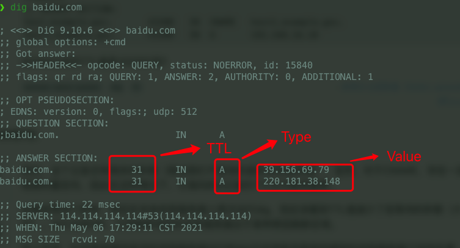

- 如果 `Type=A`，则 `Name` 是主机名信息，`Value` 是该主机名对应的 IP 地址。这样的 RR 记录了一条主机名到 IP 地址的映射。
- 如果 `Type=AAAA`（与 `A` 记录非常相似），唯一的区别是 A 记录使用的是 IPv4，而 `AAAA` 记录使用的是 IPv6。
- 如果 `Type=CNAME`（Canonical Name Record，真实名称记录），则 `Value` 是别名为 `Name` 的主机对应的规范主机名。`Value` 值才是规范主机名。`CNAME` 记录将一个主机名映射到另一个主机名。`CNAME` 记录用于为现有的 `A` 记录创建别名。下文有示例。
- 如果 `Type=NS`，则 `Name` 是个域，而 `Value` 是个知道如何获得该域中主机 IP 地址的权威 DNS 服务器的主机名。通常这样的 RR 是由 TLD 服务器发布的。
- 如果 `Type=MX`，则 `Value` 是个别名为 `Name` 的邮件服务器的规范主机名。既然有了 `MX` 记录，那么邮件服务器可以和其他服务器使用相同的别名。为了获得邮件服务器的规范主机名，需要请求 `MX` 记录；为了获得其他服务器的规范主机名，需要请求 `CNAME` 记录。


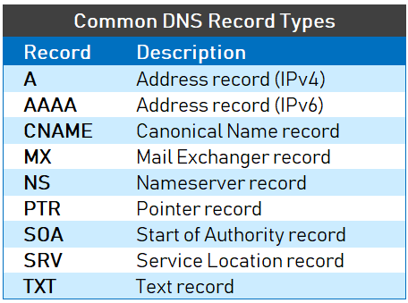

```text
根服务器 (.)
    ↓ 告诉你 ".com" 的权威服务器是谁
.com TLD 服务器
    ↓ 告诉你 "example.com" 的权威服务器是谁
example.com 的权威服务器
    ↓ 告诉你 www.example.com 的 IP 是什么
返回 A 记录
```

# 2、论文解读——DNS字符组成

## 2.1、阶段一

域名标签只能包含

- 字母：`a-z`和`A-Z`
- 数字：`0-9`
- 连字符：`-`

例如：`a.bb.com`


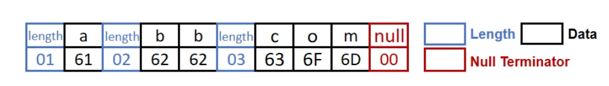

## 2.2、阶段二

随着互联网的发展，域名字符集经历的重大变化，在 RFC2181 里指出：在协议层面，域名应该被视为不透明的二进制标签，不受字符限制，以此提高协议层面的灵活性。


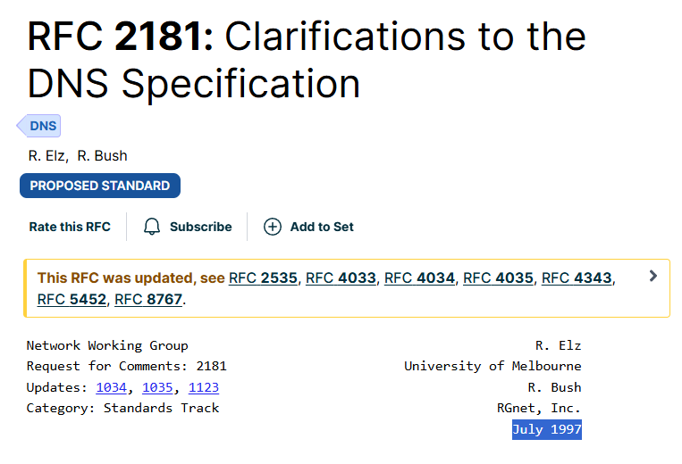


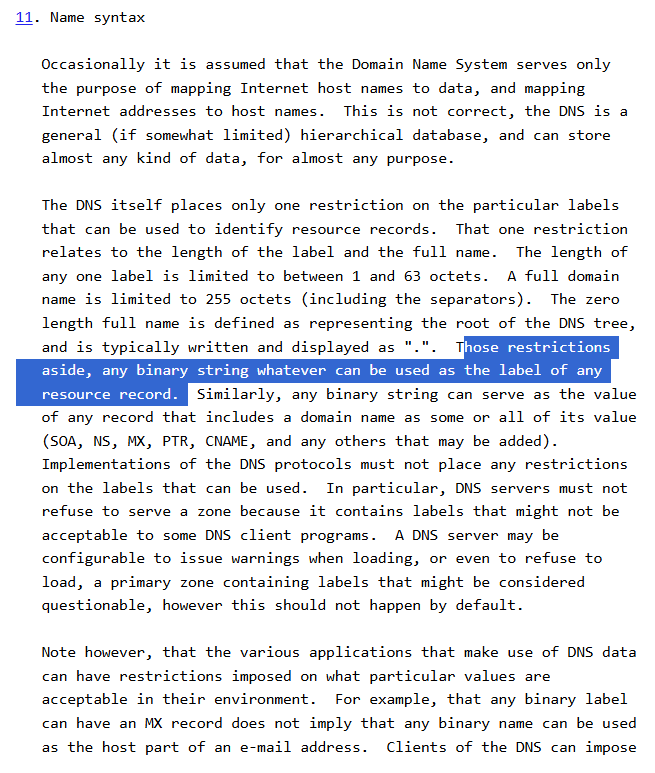

## 2.3、阶段三

1. DNS引入了国际化域名：IDN（International Domain Name 国际化域名）：允许使用 Unicode 字符，旨在解决域名如何支持中文、日文、阿拉伯文等非 ASCII 字符的问题。但是实际 DNS 查询还是要使用对应的 **ASCII 编码形式**，因此必须使用 Puncycode 编码**将 Unicode 字符序列转换成 ASCII 字符序列**。
2. IDNA 2008：（Internationalized Domain Names in Applications）：规定哪些 Unicode 字符可以用作国际化域名，以及如何保证域名处理的一致性。例如 Unicode 中可能存在的问题：
    - 同一个字符在 Unicode 中可能有不同的表示方式。
    -  有些字符属于控制字符或其他不适合用于国际化域名的字符。
    -  阿拉伯文等语言具有从右向左书写的特征。
    -  某些字符只有在特定上下文中才能合法出现。

单纯将所有 Unicode 字符转换成 Punycode 并不意味着得到的域名就是合法的 IDN。

3. IDNA2008 并没有规定所有应用程序必须执行完全相同的字符映射和预处理操作。实际浏览器还可能采用其他兼容处理机制。因此，各软件实现仍有产生行为差异的空间。

## 2.4、论文将什么视为特殊字符

对整个 ASCII 字符集。将所有的**非字母、数字（a-z、A-Z、0-9）**字符视为特殊字符。

43个公共DNS服务器对于 ASCII 特殊字符的支持情况，图片截取部分


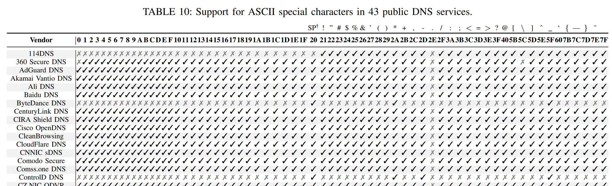

支持 ASCII 特殊字符的31款DNS软件、22款Wi-Fi路由器和6款Wi-Fi路由器操作系统。


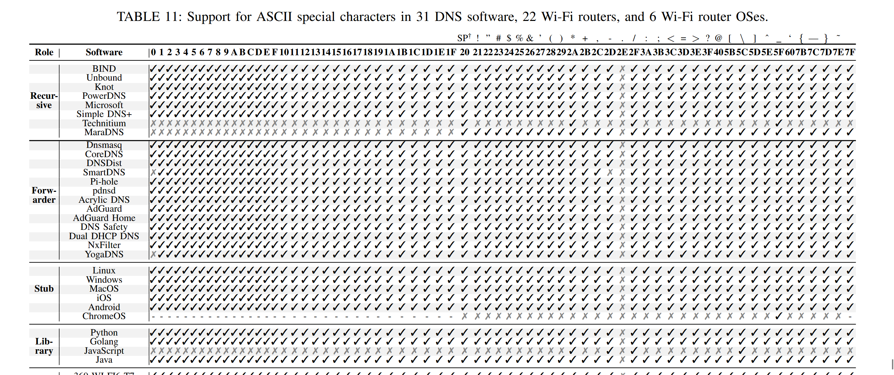

## 2.5、域名解析

论文中的域名解析流程图


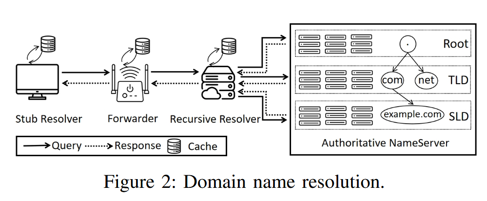

中间组件可以实施缓存、过滤、协议规范化策略。同时也引入了潜在漏洞，主要源于解析过程中不同角色对特殊字符的处理或解释不一致。

# 3、两类DNS攻击方式

## 3.1、DNS缓存投毒

### 3.1.1、DNS缓存

例如递归解析器需要解析 `www.example.com`可能需要依次查询：`Root Server → TLD Server → Authoritative Nameserver`。每次查询相同域名，都需要重新执行这套流程，显然会产生大量的网络通信开销。因此 DNS 引入了缓存机制，递归解析器会将 DNS 记录缓存在本地，之后请求同一个域名时，如果缓存依旧有效，就可以直接返回缓存内的 IP，而无需重新向权威服务器查询。

TTL：DNS 资源记录中的 TTL 决定记录可以在缓存中保留的时间，缓存到期后通常需要重新查询。

### 3.1.2、投毒核心思想

攻击者让 DNS 解析器将伪造的 DNS 资源记录作为可信结果缓存下来，从而影响后续 DNS 查询。

| | 域名 | IP地址 |
| --- | --- | --- |
| 正常记录 | `www.example.com` | `203.0.113.10` |
| 投毒记录 | `www.example.com` | `198.51.100.20` |

### 3.1.3、攻击流程


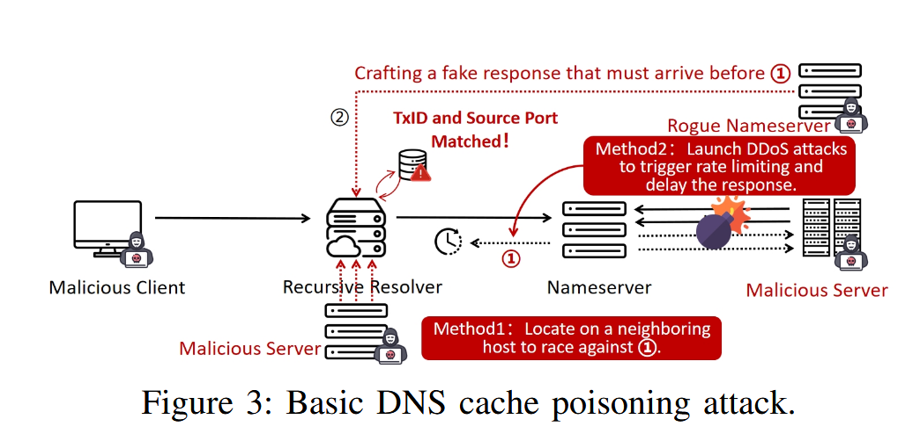

先是最左侧的Malicious Client进行攻击触发，让递归解析器去上游权威服务器查询数据

然后同时操控Rogue Nameserver充当实际的Nameserver欺骗递归解析器发回虚假的IP地址。

但是这必须要赶在Nameserver之前完成response。因此可以使用两种方式：

- 要么是在递归解析器旁边的主机（Neighboring host）上部署恶意服务器，即把Rogue Nameserver部署在物理距离递归解析器很近的主机上
- 要么使用DDoS造成网络拥塞，拖延Nameserver的响应时间，从而让Rogue Nameserver更可能赶在Nameserver之前返回数据

### 3.1.4、攻击面临的挑战

1. 猜中 TxID 和 UDP 源端口
2. 伪造响应时间必须在合法响应之前到达

#### TxID 和 UDP Source Port

DNS 通常使用 UDP 传输查询和响应。由于递归解析器可能同时处理很多 DNS 查询，因此它必须能够判断：

_收到的某个 DNS 响应，究竟对应之前发送的哪次 DNS 查询？_

为此，DNS 使用 Transaction ID（TxID）标识事务，同时通过 UDP 端口、IP 地址以及 DNS 消息内容等信息匹配请求和响应

| 字段 | 位数 | 作用 |
| --- | --- | --- |
| TxID | 16 bit | 区分不同的 DNS 查询事务 |
| UDP Source Port | 16 bit | 解析器发出查询时使用的 UDP 源端口，响应通常需要返回该端口 |

因此权威服务器再向递归服务器返回响应时必须要知道：TxID、UDP Source Port，因此攻击者就必须知道这两个字段。假设两个字段都有完整的 16 bit，那么理论上这两个字段的组合有：$2^{16} \times 2^{16} = 2^{32}$，即约有：42.9 亿种组合。因此攻击者只能随机猜测去在伪造响应时来匹配这两个字段，难度很大。

#### 时间窗口

论文指出传统 DNS 缓存投毒攻击中的响应竞争窗口通常只有大约：80 ~ 100ms。如果攻击者没能在该时间内猜出正确的 TxID 和 UDP Source Port，那么合法响应就会到达并且被递归解析器接受，则本轮攻击机会就结束了

### 3.1.5、攻击方式

#### On-path Attack（路径内攻击）

攻击者能够位于 DNS 查询通信路径上，因此有机会观察、拦截或者修改 DNS 数据包。

但是问题在于，现实中攻击者通常很难控制目标的 DNS 通信路径。因此此类方式基本不太现实

#### Off-path Attack（路径外攻击）

攻击者不位于合法 DNS 查询与响应的通信路径上，不能直接观察目标查询中的随机字段，但仍试图伪造 DNS 响应。

攻击者的攻击流程就是上述的流程：猜测TxID和端口，在时间窗口内尝试注入伪造响应

一个著名的攻击：Kaminsky DNS Cache Poisoning Attack（2008）

Kaminsky 攻击利用随机子域名不断触发新的 DNS 查询，从而创造大量投毒机会，而不必反复等待同一条缓存记录过期。

例如：

```text
abc123.example.com
xyz456.example.com
qwe789.example.com
...
```

这些随机子域名通常不会命中已有缓存，因此可以迫使递归解析器不断向权威服务器发起新的查询。

攻击者利用这些查询机会持续尝试匹配 TxID，并试图注入可影响域名委派的恶意 DNS 记录。

Kaminsky 攻击促使 DNS 软件广泛采用 UDP 源端口随机化。

此前如果源端口是固定的，攻击者可能只需猜测 16 bit TxID；加入随机源端口后，猜测空间大幅增加，使单纯暴力猜测越来越困难。

### 3.1.6、论文该段的作用

主要是介绍DNS缓存投毒这种攻击方式，同时引出一个关键因素那就是：**精心构造的响应必须在来自名称服务器的合法回复之前到达。这一时间限制是DNS缓存投毒在真实环境中可行性的根本所在，因此只要能延长这个时间窗口，就能增大投毒成功率**

## 3.2、DNS负载均衡破坏

负载均衡机制是用来将流量均衡到多台服务器上，避免单个服务器流量过大。

一个域名可以有多个权威 DNS 服务器，当递归解析器去向权威服务器发送DNS查询时，其会倾向避免向没有响应的服务器发送查询，而是优先选择性能更好的服务器


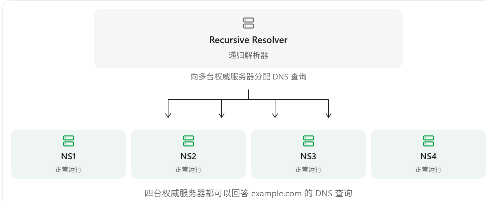

正常情况下，四台域名服务器的流量都比较均衡，我们假设流量均分，因此如下：


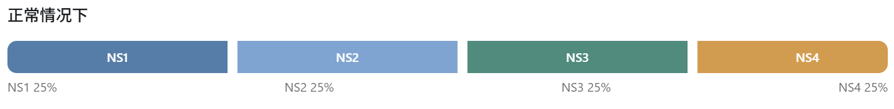

攻击者进行负载均衡破坏时，会使用一些手段，让递归解析器错误地意味NS1、NS2、NS3的服务质量很差，导致递归服务器大量选择NS4，从而使得NS4的负载过大


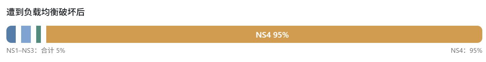

NS4 原本只需要处理一部分查询，但现在承担了绝大多数流量。可能使 NS4 负载激增，甚至出现响应延迟上升、服务不可用等问题

# 4、SHAR攻击

论文提出的新型攻击方式，利用两类新的漏洞（特殊字符处理时的**不一致性**和**静默行为**），可以进行四种攻击（$V_{EN}$、$V_{BF}$、$V_{LB}$、$V_{SF}$）

## 4.1、SHAR模型


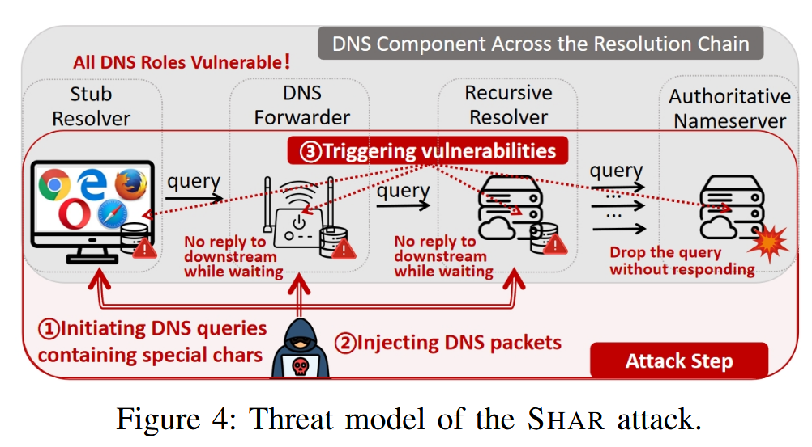

- SHAR 攻击可以针对所有的DNS角色，包括存根解析器、转发器、递归解析器

## 4.2、攻击流程

可以攻击的DNS角色：

> Stub Resolver → DNS Forwarder → Recursive Resolver → Authoritative Nameserver
>

### 4.2.1、发起包含特殊字符的DNS查询

 攻击者向目标解析器发送一个特殊构造的 DNS Query。例如：`!.example.com`，此处的`!`就是攻击者选择的特殊字符

假设：

- Recursive Resolver 支持 `!`，能够正常转发查询。
- Authoritative Nameserver 不支持 `!`，并且直接静默丢弃请求。

那么攻击者便能利用这种处理差异，使解析链路出现异常。

同时， 攻击者需要尽量确保查询可以触发新的上游请求，因为还要诱导解析器实际执行上游查询，或者触发其他有状态的处理行为。

### 4.2.2、注入DNS报文

为了实现缓存投毒而向目标解析器注入伪造的DNS响应

并且伪造的DNS响应要符合如下要求：

- DNS Transaction ID（TxID）
- UDP 目标端口（即解析器查询时使用的源端口）
- 预期上游服务器的源 IP 等地址信息
- DNS 查询内容及其他验证条件

对于论文中的 $V_{EN}$ 和 $V_{BF}$，它们属于缓存投毒类攻击方式。

### 4.2.3、触发静默漏洞


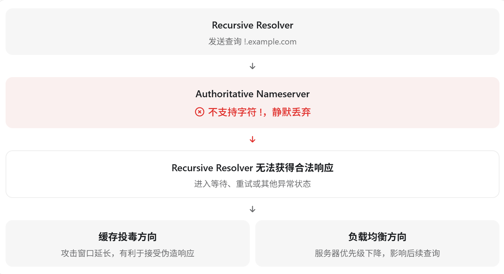

因此实际上攻击方式没有改变，还是原来就有的缓存投毒和负载均衡破坏，只不过利用了特殊字符的静默处理导致下游角色进入等待，重试或其他异常状态，那么：

- 缓存投毒：攻击窗口延长了，被攻破的概率大大增加
- 负载均衡：下游角色长时间收不到响应，认为是上游角色出现问题，因此对其进行降级，流量不再向该服务器发送，从而造成其他服务器的流量增加

## $V_{EN}$

归属：缓存投毒

通过 SHAR 静默漏洞，增强**已有的 DNS 缓存投毒攻击技术，不是新的攻击方式**

原来的 DNS 缓存投毒的攻击困难之处：

- 真实的 DNS 返回响应基本在 80 ~ 100ms，攻击者必须在该时间窗口内注入能被接受（才对TxID和源端口）的伪造响应。 为了提高成功率，过去的一些攻击需要**使权威服务器响应变慢**，或者尽量**缩短攻击者到递归解析器的网络延迟**。

$V_{EN}$的思路就是使用特殊字符，让权威服务器静默丢弃 DNS 查询，此时递归解析器无法及时获取真实响应，攻击者就有了更长的时间窗口来实时缓存投毒攻击。因此本质就是：**特殊字符的静默处理导致不给下游的递归解析器返回响应了，那么原本 80 ~ 100ms的时间窗口就会放大很多，让攻击者的机会更多**

## $V_{BF}$

归属：缓存投毒

**暴力猜测 TxID 和 源端口**

即不使用任何已有的 DNS 缓存投毒方式，就使用最原始纯粹的暴力猜测，猜测出 TxID 和源端口就可以伪造出能被递归解析器接受的DNS响应，从而达到投毒的目的。

之前暴力方法被视为不可行的原因是：TxID 有 16 bit，UDP 源端口也有 16 bit，因此一共有组合方式：

$$
2^{16} \times 2^{16} = 2^{32}
$$

大约 42.9 亿种可能组合，正常的响应时间窗口只有 80 ~ 100ms，因此纯粹的暴力破解的概率很低。但是使用特殊字符触发静默处理后，时间窗口被放大，因此为暴力破解提供了可能性

## $V_{LB}$

归属：负载均衡破坏

让递归解析器认为部分权威服务器不可用，从而把后续大量 DNS 流量集中到特定的受害者服务器

假设场景：

一个域名有四台权威服务器，NS1、NS2、NS3、NS4

攻击者寻找一种特殊字符，使得：

- NS1、NS2、NS3 收到查询后静默丢弃
- NS4 能正常回复该查询

那么攻击者只要连续发送该有该字符的 DNS 查询，使得递归解析器不断向这四台权威服务器发送请求，由于 NS1~NS3 都静默丢弃，因此递归解析器收不到其查询返回响应，只有 NS4 能正常响应，那么递归解析器就会将NS1~NS3 的优先级降级，将后续的查询流量优先发给 NS4，导致 NS4 的流量激增。

该攻击的危险之处在于，攻击者可能只需要发送一定数量的特殊字符查询，就会影响到递归解析器对于权威解析器的优先级，从而改变其他正常用户请求的DNS流量分布。

## $V_{SF}$

原理与$V_{LB}$基本一致，但是区别在于：

假设能寻找一种特殊字符，其能够**让所有的权威服务器都静默丢弃**

那么递归解析器接收不到任何权威服务器的响应，其会误以为所有的权威服务器不可用，那么后续将不会向权威服务器发送查询。这样就可能产生 DoS（Denial of Service，拒绝服务）

# 5、论文研究方式

论述作者进行了哪些实验研究

## 5.1、通用的DNS字符处理流程

论文使用如下方法对各类DNS软件的处理流程进行研究：

- RFC 标准文档分析
- 源代码审查（Source Code Review）
- 单步调试（Single-step Debugging）
- 灰盒测试（Gray-box Testing）

归纳总结为如下几步：

1. WireFormatParsing（线缆格式解析）：解析原始 DNS 报文中的域名编码，检查 Label 长度、压缩指针等
2. BasicFormatValidation（基本格式验证）：检查 DNS Header、Question、Answer 等报文结构是否正确
3. SemanticValidation（语义验证）： 检查域名字符是否合法，是否符合对应的字符与标签规则
4. PolicyValidation（策略验证）： 根据软件自身配置和安全策略进行额外检查

这四个阶段中，前两个主要关注 DNS 报文本身的格式是否正确，后两个主要关注域名内容是否被当前实现接受。

举例：假设域名为`!.example.com`的DNS查询

1. WireFormatParsing：首先要能正确解析这个域名的长度编码，并确认整个域名长度不超过 255 字节、每个 Label 长度不超过 63 字节。
2. BasicFormatValidation：检查 DNS 报文头、各个 Section 的字段和数量，以及域名结束标记等
3. SemanticValidation： 软件需要判断字符 `!` 是否被允许，此时不同的DNS软件的行为可能出现差异
    - 软件A认为`!`是允许的字符，继续处理查询
    - 软件B认为`!`不是允许的字符，拒绝处理查询
4. PolicyValidation：还可以进行更严格的字符限制

## 5.2、不同软件对特殊字符的处理

ASCII 共有 128 个字符，排除 52 个英文字母和 10 个数字后，还剩下 66 个非字母数字字符。

论文对字符 `.`(0x2E) 进行了测试 发现所有测试实现都会丢弃对应的 DNS 报文，因此将该字符排除，实际上是对 65 个字符进行测试处理。

论文里的对 31 种主流 DNS 软件进行了分析和测试，具体如下：

| DNS 角色 | 数量 | 代表软件 |
| --- | --- | --- |
| Recursive Resolver | 8 | BIND、Unbound、PowerDNS、Knot Resolver |
| DNS Forwarder | 13 | Dnsmasq、CoreDNS、Pi-hole、SmartDNS |
| Stub Resolver | 6 | Linux、Windows、macOS、Android |
| DNS Library | 4 | Python、Golang、JavaScript、Java |
| 合计 | 31 | |

### 5.2.1、测试方式

作者注册了一个域名：`attacker.com`

然后构造查询域名，格式符合：`{char}.{nonce}.attacker.com`

- `char`：要测试的特殊字符。
- `nonce`：随机字符串，用于避免 DNS 缓存命中。
- `attacker.com`：作者控制的测试域名。

例如：`!.a8f31.attacker.com`

然后将这个查询发送给待测 DNS 软件，并进行观察：

1. 特殊字符是否被支持
2. 如果特殊字符不被支持，软件会怎样处理？
3. 如果查询已经转发出去，但上游始终不响应，软件会怎样处理？

论文结合源代码检查、运行日志与出入站报文抓取，并进行多轮测试，确定了各软件的具体行为。

### 5.2.2、测试结果

#### 递归解析器：Recursive Resolver

例如：BIND 与 PowerDNS

- 两者都支持测试的 65 个特殊字符
- 当上游权威服务器静默丢弃查询不响应时：
    - BIND：不向下游返回响应
    - PowerDNS：向下游返回`SERVFAIL`

即使这两个软件对所有特殊字符都支持，但是上游发生静默处理时，这两个软件的处理行为仍然不同

#### DNS转发器：DNS Forwarder

例如：Dnsmasq 与 CoreDNS

- 都支持所测试的特殊字符
- 当上游权威服务器静默丢弃查询不响应时：
    - Dnsmasq：不向下游返回响应。
    - CoreDNS：向下游返回 `SERVFAIL`。

例如：MaraDNS

- 对特殊字符的接受范围相对有限
- 不支持不可打印字符（0x00–0x1F 和 0x7F），在测试环境下，会直接静默丢弃含有不支持字符的查询

这些软件本身就对一些特殊字符不支持，其自身就可能成为静默行为的产生位置

#### 存根解析器：Stub Resolver

例如：Linux 与 Windows

- 都可以转发这些特殊字符
-  当上游保持静默时：
    - Linux 的测试实现返回 `NXDOMAIN`
    - Windows 的测试实现不向下游返回响应

静默行为的影响并不局限于递归 DNS 服务器，也可能继续传播到客户端操作系统所在的解析环节

例如：ChromeOS

- 对特殊字符的接受范围相对有限
- ChromeOS 在论文所测试的接口和版本下，仅支持 `_` 这一种特殊字符，并且对不支持的字符不返回 DNS 响应。

自身就可能成为静默行为的产生位置

#### DNS开发库：DNS Library

除 JavaScript 外，其余 DNS 库都支持所有的特殊字符。

- Python 的 dnspython库，当上游解析器保持沉默，该库不会响应
- Golang使用 github.com/miekg/dns 库处理DNS数据包。如果上游解析器保持沉默，它将不会响应。
- Java使用 dnsjava 库处理 DNS 数据包。如果上游解析器保持沉默，它返回网络错误，接下来的两个查询被丢弃
- • JavaScript使用node:dns/promises库处理DNS数据包，并且只能转发`*`(0x2A)、`-`(0x2D)、`/`(0x2F)、`\`(0x5C)、`_`(0x5F) 字符。如果域名包含不支持的字符，它将返回查询 A EBADNAME 域。如果上游解析器保持沉默，它将不会响应。

可以看出这些 DNS 开发库也存在静默处理的问题

#### 权威服务器软件：Nameserver

测试了 7 款免费的 DNS 权威服务器软件：BIND、PowerDNS、NSD、Technitium、Knot DNS、gdnsd和MaraDNS。

结果是对于所有的特殊字符，这 7 个软件都会响应查询


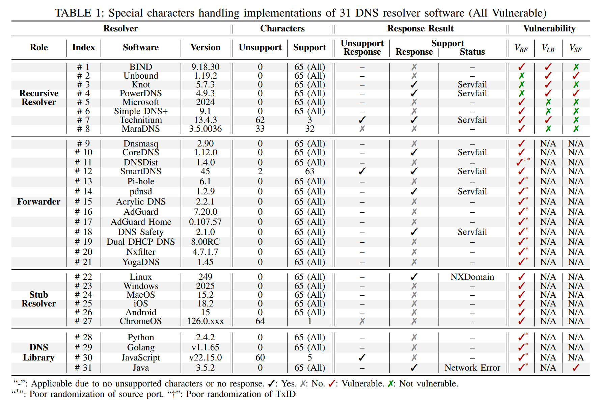

#### 结论

1. DNS 软件的特殊字符支持集合不完全一致。
2. DNS 软件对异常查询和上游静默的处理方式也不一致。

### 5.2.3、特殊字符的漏洞

#### 缓存投毒类型

$V_{EN}$、$V_{BF}$

#### 负载均衡破坏类型

$V_{LB}$、$V_{SF}$

# 6、具体如何进行攻击

## 6.1、实验环境搭建

论文使用 Go 编写攻击程序，并在受控环境中部署了多种 DNS 软件，包括 Dnsmasq、BIND、Unbound、Knot、PowerDNS、Technitium、Microsoft DNS、MaraDNS 和 Simple DNS+。

- Linux 侧使用 Ubuntu 24.04，部分 DNS 软件部署在 Windows Server 2025 上。
- 每个测试域名配置 4 台权威服务器。
- 攻击程序与实验服务器连接在同一局域网中，带宽为 500 Mbps，并配置公网 IP。
- 对 VBF、VLB、VSF 进行了端到端攻击实验；对 VEN 则主要分析并复现已有缓存投毒技术，研究 SHAR 对这些技术的增强效果。

## 6.2、缓存投毒类

### $V_{EN}$

攻击方式使用本身就已经有的缓存投毒方法，不过利用了特殊字符处理的不一致性和静默处理，造成的时间窗口延长从而增加原本已有缓存投毒方法的成功概率。

论文支出正常合理的时间窗口在：80 ~ 100ms，但是使用 SHAR 攻击后，能将攻击的时间窗口扩大 60 倍以上

具体的攻击模型


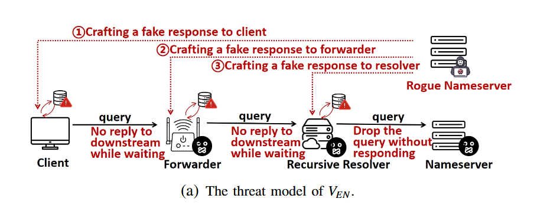

论文具体对 2002 年至 2025 年间所有的off-path缓存投毒攻击使用了$V_{EN}$进行了增强复现实验，最终得出结果


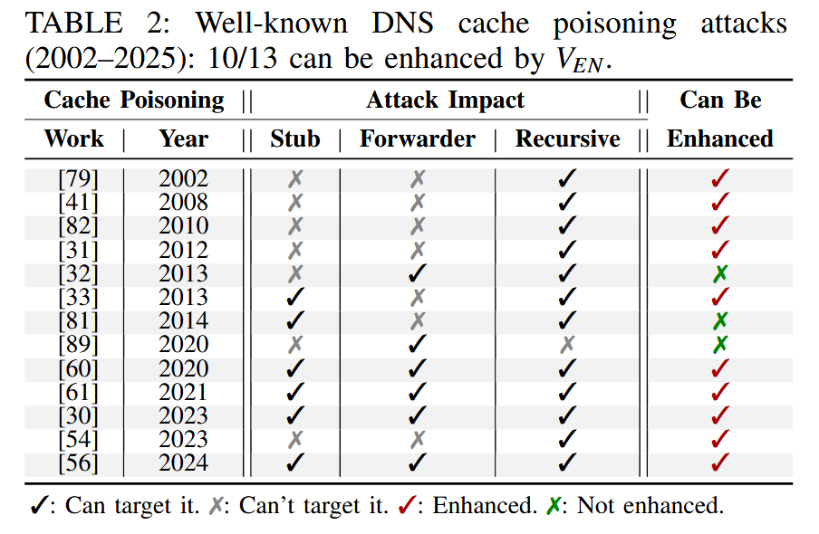

其中不受增强的三种攻击方式的原因是：这些方法是利用 IP 分片攻击，由于伪造的 IP 分片可以在缓冲区保留较长时间（论文提及30秒），其攻击方式并不依赖与名称服务器的竞争，因此延长攻击时间窗口对这些方法影响不大

### $V_{BF}$

该方法的原理就是利用最基础的攻击，即赶在权威名称服务器之前把伪造的响应返回给下游即可。主要还是利用攻击时间窗口的延长来暴力破解出 TxID 和 UDP源端口

具体的方式：

首先，对于 TxID 和 UDP 源端口都是 16 bit 长度，因此理论的猜测空间是：$2^{16} \times 2^{16} = 2^{32}$

论文采用分轮尝试的方法：

每轮覆盖全部 65536 个 TxID，同时猜测 5 个候选源端口，因此一轮对应的候选组合数量为：

$$
5 \times 65,536 = 327,680
$$

假设真实端口的有效候选空间为 65,536，且近似均匀随机，那么只要这一轮猜中了正确端口，由于全部 TxID 都已经被尝试，就有机会找到正确的组合。

因此一轮的成功概率近似为：$p = \frac{5}{65,536}$

$V_{BF}$**并不是在一次 DNS 查询中尝试完全部**$2^{32}$**种组合，而是在不同查询轮次中，逐渐积累成功机会。如果一轮失败，就构造新的随机子域名，发起下一轮 DNS 查询。**

论文中的概率公式：

$$
P_{\text{success}} = 1 - (1 - \frac{5}{65,536})^{x}
$$

- $x$：攻击轮次数量。
- $\frac{5}{65,536}$：一轮成功猜中目标端口的近似概率。
- $1 - \frac{5}{65,536}$：一轮未猜中目标端口的概率。
- $(1 - \frac{5}{65,536})^x$：在独立轮次假设下，连续$x$轮均失败的概率

因此只要不断地尝试，那么全部失败的概率会越来越小，因此成功概率就会越来越大

#### 攻击模型


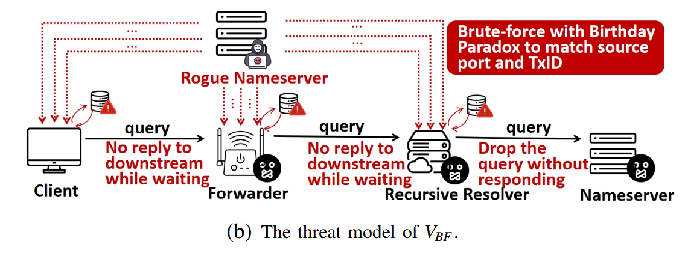

#### 理论分析

首先论文明确说明了，传统DNS响应竞争和特殊字符触发漏洞后的时间窗口的变化：

| 情况 | 时间窗口 | 原文位置 |
| --- | --- | --- |
| 传统 DNS 响应竞争 | 80–100 ms | as attackers generally have only a narrow time window (80–100ms) to attempt it. |
| SHAR 导致静默的示例 | 约 5 s | This behavior causes resolvers to remain waiting without timely termination (e.g., 5s) |
| MaraDNS、CoreDNS | 约 6 s | BIND and Unbound can provide a 10s attack window, MaraDNS and CoreDNS allow for a 6s window, and Dnsmasq offers over 10s [55]. |
| BIND、Unbound | 约 10 s | 同上 |
| Dnsmasq | 超过 10 s | 同上 |

论文中提及了每轮猜测需要 1 秒

> Based on the Birthday Paradox, the probability of a successful attack increases with the number of guessing rounds **(each taking 1s)**.
>

每轮要覆盖 327680 次猜测

因此平均报文发送速率是：

$$
R = \frac{327,680}{1} = \boxed{327,680\ \text{packets/s}}
$$

每秒约 32.8 万个报文。

假设必须在指定窗口中完整发送 327680 个报文，那么针对不同的时间窗口需要如下的发包速度


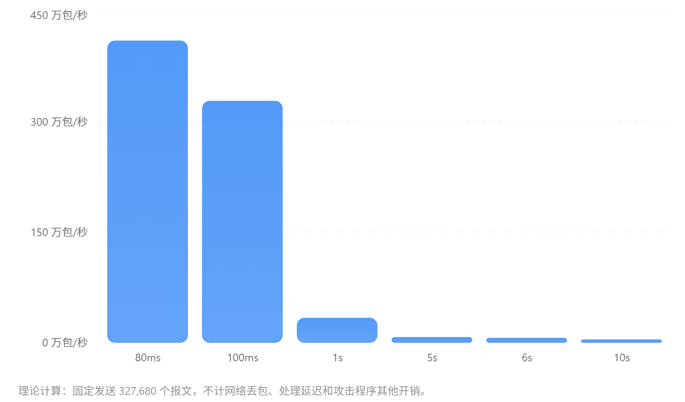

可以看到正常的时间窗口（80 ~ 100ms）需要发包速度为：每秒300万~400万个包

论文中搭建的实验平台的网络带宽是：500 Mbps，攻击过程中的峰值带宽是 297 Mbps

假设伪造一个 DNS 响应报文的平均字节是 110 B（仅是假设）

那么一轮 327680 个报文需要传输的数据量是：

$$
327,680 \times 110 \times 8 = 288,358,400\ \text{bits}
$$

如果 1 秒内发送完成，那么带宽约为：$B \approx 288.4\ \text{Mbps}$，与实验基本吻合。

假设在正常的时间窗口（100 ms）内发送完全部报文，需要：$B \approx 2.88\ \text{Gbps}$，远高于实验网络的 500 Mbps。

即使保持 287 Mbps 的峰值带宽进行传输，那么 100 ms 也只能发送：

$$
N \approx \frac{297 \times 10^6 \times 0.1}{110 \times 8} = 33,750
$$

甚至无法遍历完一个端口全部的 TxID

#### 实验结果

作者选择了三种典型的 DNS 软件作为攻击对象：

- Linux：代表 Stub Resolver。
- Dnsmasq：代表 DNS Forwarder。
- BIND：代表 Recursive Resolver。

每种软件重复攻击 20 次，结果如下：


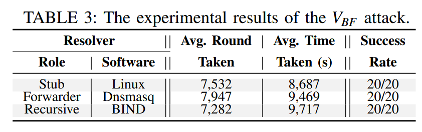

实验中，最短成功投毒时间为Dnsmasq 193秒、Linux 228秒、BIND 971秒。记录的最长时间为Dnsmasq 21,903秒、Linux 20,100秒、BIND 20,983秒。

#### 总结

$V_{BF}$证明了在特定威胁模型下，原本因为时间窗口太短而被认为不可行的直接暴力猜测，可以借助 DNS 静默行为重新实现。

## 6.3、负载均衡破坏类

### $V_{LB}$


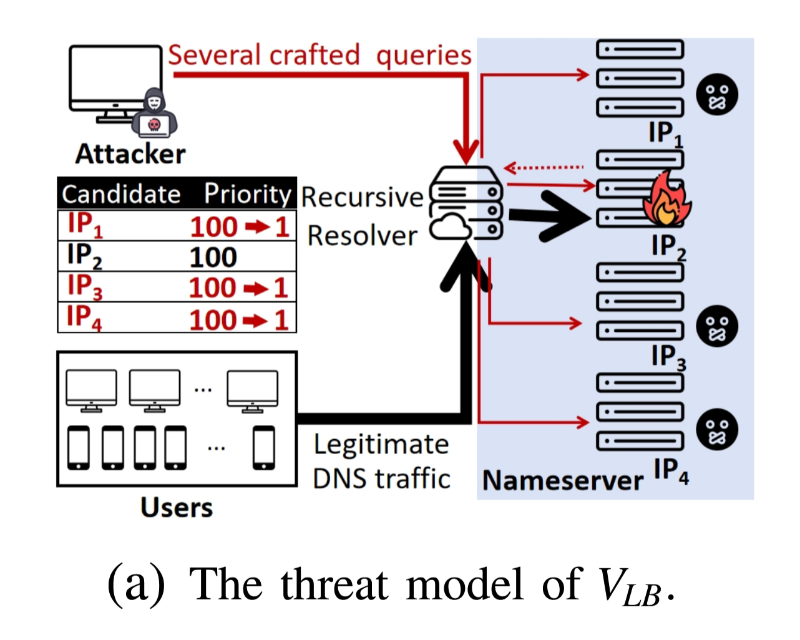

1. 发送大量特殊字符 DNS 查询。

例如 `{char}.{nonce}.attacker.com`，每次使用不同的 `nonce` 避免缓存命中。

2. 使递归解析器向多台权威服务器发送查询。

作者强调需要发送多次查询，确保每台权威服务器至少有机会收到一次请求。

3. 诱导递归解析器调整服务器优先级。

NS1、NS2、NS3 静默，NS4 正常响应。于是解析器降低前三者的选择优先级。

4. 后续正常查询逐渐集中到 NS4。

即使之后查询的域名不含特殊字符，递归解析器仍然可能继续偏好 NS4。

### $V_{SF}$


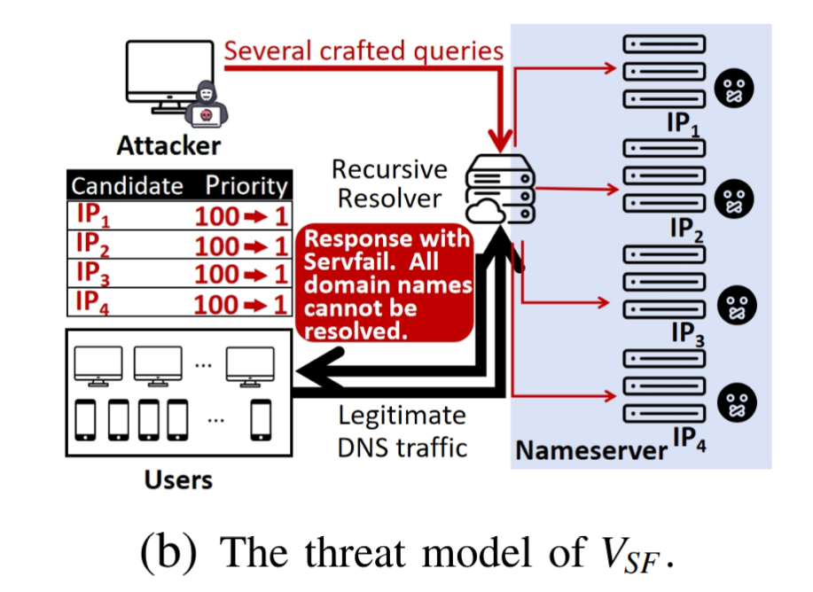

1. 攻击者发送特殊字符查询
2. 四台权威服务器全部静默
3. 递归解析器将所有权威服务器判断为不可用
4. 正常用户也无法解析域名，形成 DoS 效果

### 实验结果


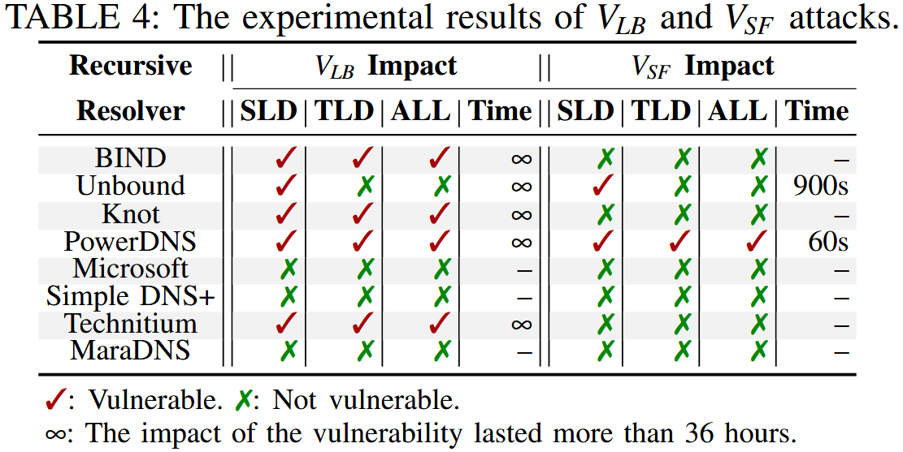

## 6.4、讨论实际攻击条件和影响范围

作者对其提出的 SHAR 4个攻击方式在实际网络中的影响进行了分析，包含四个方面：多个权威服务器、多个后端 IP、查询名最小化、 特殊字符查询攻击范围

### 多个权威服务器

现实中，一个域名通常配置多台权威服务器。

对于传统 DNS 缓存投毒，这会增加攻击难度。

因为递归解析器可能同时或依次向多个服务器查询，只要其中一台及时返回真实响应，攻击者就可能失去注入机会。

但是 SHAR 的特点是： 如果能够找到使相关上游服务器都保持静默的字符，那么即使域名有多个权威服务器，也未必能够缩短攻击窗口。

因此作者认为，多权威服务器部署并不能天然防御 SHAR

### 多个后端 IP

一些公共 DNS 服务并不只由一台机器提供服务。

例如，一个公共 DNS 地址可能通过 Anycast、负载均衡等机制，对应不同的后端解析器实例。

因此会对缓存投毒带来额外难度：攻击者需要确定究竟哪个后端处理了目标查询，才能向正确的目标尝试注入响应

作者指出，虽然公共 DNS 服务可能包含大量后端，但从特定地理位置访问时，实际上参与处理请求的出口 IP 往往只有较少几个，例如 1～4 个。

因此，多个后端 IP 会增加攻击复杂度，但未必完全阻止 SHAR。

### 查询名最小化

QNAME Minimization，简称 qmin

即每层名称服务器只关注自己部分的查询，示例：

查询：`www.example.com`

| 查询目标 | 发送给该层服务器的查询名示意 |
| --- | --- |
| 根服务器（Root） | `com` |
| .com 顶级域权威服务器（TLD） | `example.com` |
| example.com 权威服务器 | `www.example.com` |

使用了 qmin 后，对于 TLD 只会收到`example.com`的查询

假设使用 SHAR 攻击，使用域名`!.exmaple.com`，TLD 并不会接收到`!`，因此不会造成影响

所以使用 qmin 可以降低某些针对 TLD 的 SHAR 攻击效果

但是最终查询`!.example.com`时仍会使用完整的域名给`example.com`权威服务器，如果权威服务器静默丢弃`!`，攻击仍会成立

因此作者表明：QNAME Minimization 能够限制 SHAR 的部分攻击路径，尤其是 TLD 层级的攻击，但并不能完全消除其影响。

### 特殊字符查询攻击范围

特殊字符查询是触发漏洞的手段，并非限制攻击效果只能作用域特殊字符的域名

对于缓存投毒类，假设使用`!.example.com`进行漏洞触发，并非只影响`!.example.com`的 A 记录

DNS 响应报文一般有如下结构：

- Question Section：本次查询的名称和类型，例如：`!.example.com A`
- Answer Section：对查询问题的直接回答，例如该名称对应的 A
- Authority Section：权威信息，例如 NS 记录
- Additional Section：附加信息，例如 NS 主机名对应的地址记录

即伪造的 DNS 响应可以对 NS 记录进行修改，伪造真实的 NS 服务器的地址，如果目标解析器接受并缓存了这些伪造的记录，那么后续对`example.com`区域的查询就可能被重定向到攻击者控制的服务器。

针对 DNS Forwarder，可以通过 CNAME 链扩大影响，CNAME 记录表示一个域名是另一个域名的别名

```text
a.example.com  CNAME  b.example.net
b.example.net  CNAME  c.example.org
c.example.org  A      192.0.2.10
```

当用户查询 a.example.com 时，解析器会沿着 CNAME 链继续解析，最终得到 `c.example.org`对应的地址，伪造的响应可以对 CNAME 进行恶意修改，那么可能整个链上的解析关系都会被污染。

## 6.5、与已有攻击的区别

1. 以往的研究已经发现了一些特殊字符处理问题，例如：`\``0x00`等字符在不同 DNS 实现之间可能产生解析歧义 攻击者能够利用这些歧义实施注入攻击。

但是论文研究的是：系统地分析多个 DNS 角色对 ASCII 特殊字符的支持情况，以及不支持字符时产生的静默处理行为。

2. 和已有的缓存投毒攻击相比，SHAR 使用了新的切入点，其不直接降低猜测空间，而是利用静默行为增加可以尝试猜测的时间。
3. 和已有的负载均衡破坏攻击相比，SHAR 仅使用特殊字符就能诱发权威服务器静默，并且$V_{SF}$理论上还可以导致整个 DNS 解析服务不可用

# 7、现实环境中的易受攻击 DNS 组件

## 7.1、Wi-Fi 路由器与路由器操作系统

21 台路由器、6 种路由器操作系统。考察家庭网络入口处的 DNS 转发和缓存行为。

家庭路由器通常不只是一个网络转发设备，也可能承担 DNS Forwarder（DNS 转发器）的角色。

这就产生两个不同的研究问题：

1. 路由器自身是否容易受到 VBF 相关缓存投毒攻击？
2. 路由器是否会将这种异常行为传递给下游解析器，造成进一步的攻击机会？

论文测试了 21 台 Wi-Fi 路由器和 6 种路由器操作系统，共 27 个对象。

作者将受控服务器配置为上游 DNS，测试设备对包含特殊字符的 DNS 查询的处理方式，以及上游不响应时的行为。

由于路由器通常不实现递归解析器那样的权威服务器负载均衡机制，本节主要关注缓存投毒相关风险，而不是 VLB 和 VSF。

### 实验结果
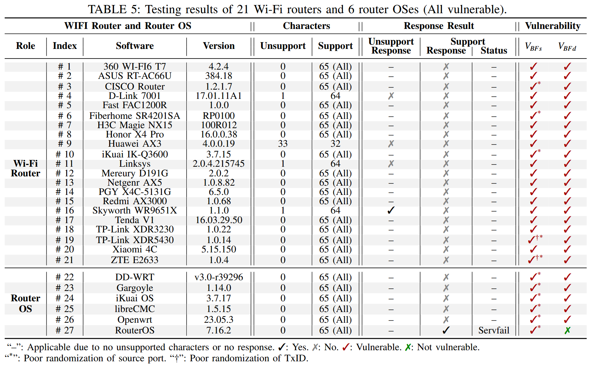

- $V_{BFs}$：路由器自身受到相关漏洞影响。
- $V_{BFd}$：路由器可能使下游解析器暴露于$V_{BF}$风险。
- 测试对象 27 个
- $V_{BFs}$易受影响：27 个
- $V_{BFd}$易受影响：26 个
- 源端口和/或 TxID 随机化存在问题：11 个

## 7.2、公共 DNS 服务

43 个公共 DNS 服务。考察公共解析服务是否容易受到 SHAR 的不同攻击变体影响。

### 实验方法

- 对 $V_{BF}$，使用研究者控制的域名测试特殊字符处理行为，查询速率限制在每秒 200 次，没有直接对这些公共服务实施实际投毒攻击。
- 对$V_{LB}$和$V_{SF}$，在受控域名中配置 4 台权威服务器，并发送 4,000 个 DNS 查询，观察解析器对不同权威服务器的请求分布和处理方式。

### 实验结果
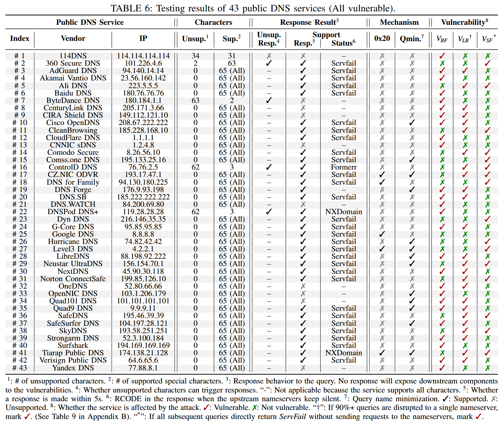
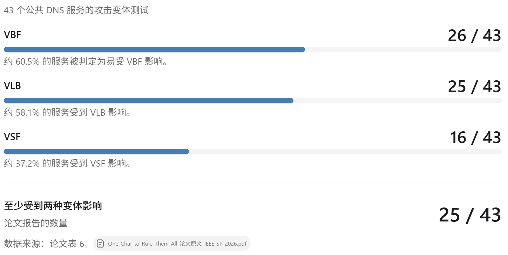

## 7.3、开放 DNS 解析器

883,500 个稳定活跃的解析器。研究漏洞在互联网中的分布规模。

Open DNS Resolver 指能够接受来自外部网络的 DNS 查询并进行解析的解析器。

它可能是：

- DNS Forwarder；
- 递归解析器；
- 或同时承担相关功能的 DNS 服务。

如果大量开放解析器存在相似漏洞，攻击面就可能远超前面测试的路由器和公共 DNS 服务。

### 实验方法

- 使用 XMap 扫描 IPv4 地址空间的 UDP 53 端口，针对研究者控制的域名识别开放解析器。
- 排除返回错误响应的对象，并筛选在 2025 年 4 月 5 日至 5 月 5 日期间持续活跃的解析器。
- 向这些解析器发送包含特殊字符的 DNS 查询，并在研究者控制的权威服务器上观察查询行为，以识别解析器对特殊字符的处理方式。
- 进一步测试：当所有权威服务器都对相应查询保持静默时，解析器是否也会保持静默，从而使下游组件暴露于风险。

### 实验结果
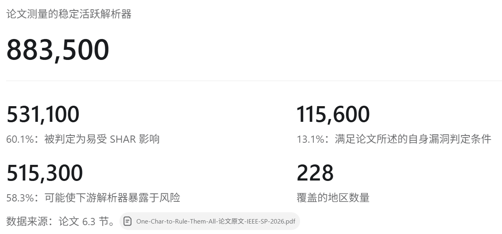

结论：在作者测量的稳定开放解析器中，有 60.1% 被判定存在 SHAR 相关风险，说明这种问题并非局限于少数特定 DNS 软件。

## 7.4、权威 DNS 服务器

Root、TLD、SLD 三个层级。研究哪些权威服务器会因特殊字符查询而静默。

### 实验方法

作者测量了三个层级的权威服务器：

| 层级 | 测量对象 | 主要研究目标 |
| --- | --- | --- |
| Root | 全部 13 个根服务器标识所对应的 IPv4、IPv6 服务 | 判断互联网 DNS 根层是否存在静默漏洞 |
| TLD | 1,445 个顶级域，合计 14,660 台权威服务器 | 判断哪些 TLD 的权威服务可能受到影响 |
| SLD | Tranco Top-1M 域名对应的权威服务器 | 判断二级域权威服务器的实际脆弱比例 |

采用的判断标准是：如果服务器能够响应正常查询，却在包含某些特殊字符的查询发出后 5 秒内没有响应，就将其判定为存在相关静默漏洞。

为了降低 Anycast（任播）和负载路由对结果的影响，作者从美国俄勒冈、德国法兰克福和新加坡三个测量点进行了 5 轮测试。

### 实验结果

#### Root

论文报告，测量中的根服务器没有受到所研究的这些静默漏洞影响。

#### TLD
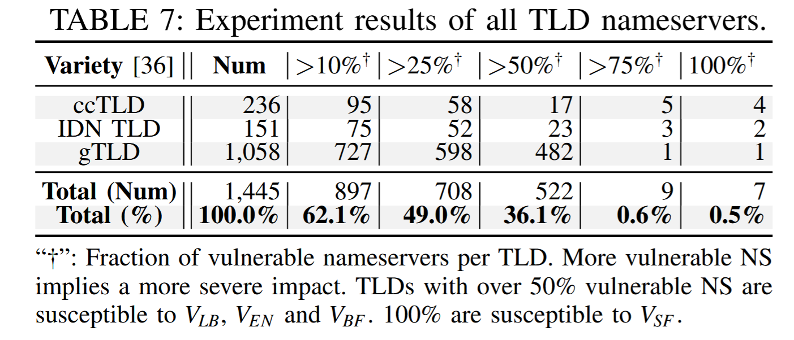

- 897 个 TLD 中，超过 10% 的权威服务器存在静默漏洞。
- 708 个 TLD 中，超过 25% 的权威服务器存在静默漏洞。
- 522 个 TLD 中，超过 50% 的权威服务器存在静默漏洞。
- 7 个 TLD 的权威服务器全部存在该问题。

论文据此指出：

- VLB：522 个 TLD（36.1%）满足论文设定的超过 50% 权威服务器易受影响的条件。
- VSF：7 个 TLD（0.5%）的权威服务器全部易受影响，因此满足论文针对 VSF 的条件。

#### SLD

在二级域层级，作者递归遍历 Tranco Top-1M 域名的解析拓扑，提取对应的 SLD 权威服务器。

测量得到：

- 108,500 台在 2025 年 4 月 5 日至 5 月 7 日期间持续活跃的 SLD 权威服务器。
- 其中 5,600 台，即 5.2%，存在相关静默漏洞。

### 本节结论

根服务器没有发现相关问题，但在 TLD 和 SLD 层级，论文发现了大量满足 SHAR 攻击条件的权威服务器。这些测量结果为第五章所讨论的跨域、跨区域影响提供了现实依据。

## 7.5、域名总体影响评估

这些存在漏洞的服务器，可能影响多少实际域名？

作者从 ICANN 的 Centralized Zone Data Service（CZDS）获得 1,093 份 TLD 区域文件，从中提取出总计 223.6M（约 2.236 亿）个域名。

接下来，作者设计了两种不同的评估方法：TLDScope 和 SLD-NScope。

### 方法一、TLDScope

TLDScope 从 TLD 层级评估风险。

如果某个 TLD 超过 50% 的权威服务器存在静默漏洞，那么该 TLD 下的域名都被视为存在潜在风险。

论文通过该方法识别出 1,140 万个域名，占总数的 5.1%。

### 方法二、SLD-NScope

SLD-NScope 具体域名的 SLD 权威服务器入手

如果某个域名超过 50% 的 SLD 权威服务器存在静默漏洞，就将该域名标记为易受影响。

论文通过该方法识别出 120 万个域名，占总数的 0.5%。

### 实验结果
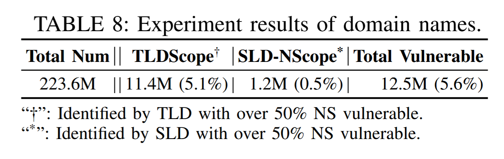
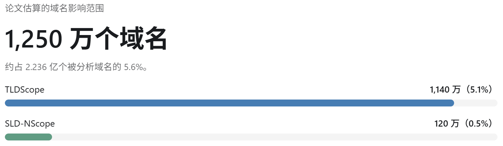

# 8、缓解措施

## 8.1、统一特殊字符处理规则，消除静默漏洞

论文指出，DNS 各种实现对字符处理的理解存在差异，作者建议各 DNS 角色按照 RFC 2181 的协议要求支持完整的 DNS 字符范围。

当遇到不支持的字符，或者上游权威服务器无响应时，解析器应当返回明确的错误响应，例如：

- `SERVFAIL`：服务器未能完成查询。
- `REFUSED`：服务器拒绝执行该查询操作。

这样下游就能够收到确定的处理结果，而不必持续等待。从而避免静默处理

## 8.2、针对 VEN 和 VBF，加强缓存投毒防御

### 0x20 Encoding

DNS 域名中的英文字母不区分大小写，但其原始大小写形式可以在报文中保留。

例如，对于：

`www.example.com`

解析器可以随机修改英文字母大小写，生成：

`wWw.eXaMpLe.cOm`

然后检查收到的 DNS 响应是否保留了预期的大小写模式。

这样，攻击者除了需要猜测 TxID 和源端口，还可能需要猜测额外的大小写模式。

### DNSSEC

DNSSEC（DNS Security Extensions）通过数字签名，为 DNS 数据提供来源真实性和完整性验证。

如果攻击者伪造一条 DNS 响应，即使成功匹配 TxID 和源端口，在目标区域得到适当签名保护、解析器正确执行 DNSSEC 验证的情况下，伪造记录仍然不能通过密码学验证。

因此，DNSSEC 是比单纯增加随机猜测难度更强的缓存投毒防御。

### 异常检测与速率限制

使用异常检测、速率限制等方式，降低恶意响应注入的成功可能性

## 8.3、针对 VLB 和 VSF，改进负载均衡算法

递归解析器应该定期重新探测低优先级的权威服务器。避免长期错误判断
